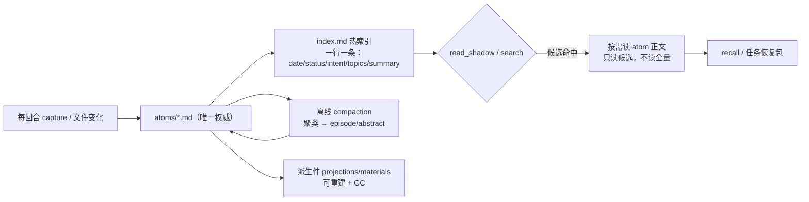

# dsh-shadow 记忆文件太多：竞品 / 开源项目 / X 调研与可借鉴方案

- 日期：2026-10-30
- 范围：dsh-shadow v2.2.0（`D:\project\dsh-shadow`，HEAD `8c46c96`）
- 方法：官方文档 + GitHub API 读 README/源码 + X 原帖；**不把二手总结当一手证据**
- 口径：**事实**＝可点开的来源；**判断**＝基于事实的推断；**未验证**＝没有真机/实验证据

## 0. 结论（TL;DR）

1. **“文件太多”在 dsh-shadow 里是两层问题**：
   - **记忆 atoms**：每回合一条，当前工作区已 **906 条 / 629 KB**；`read_shadow` 每次 `loadAtoms` 全量读 906 个文件。
   - **派生件**：`.shadow/indexes` 已有 **694 个 projection + 119 个 materials + 大量 `.history`**，全 `.shadow` **1,934 文件 / 14.2 MB**（其中 SQLite 约 10 MB），**没有 GC**。
2. 竞品的共同答案不是“换数据库”，而是 **索引 + 按需正文 + 时效/合并 + 采集门禁**：
   - **Claude Code**：`MEMORY.md` 只加载前 **200 行或 25 KB**，topic 文件按需读；`CLAUDE.md` 单文件上限 **4 MiB**。
   - **GitHub Copilot Memory**：仓库事实 / 用户偏好分域，**默认 90 天过期（可配 7–180 天）**；被 upvote 才续期；**不是所有记忆都随 prompt 发送**。
   - **agent-memory / memsearch / Basic Memory**：Markdown 是唯一事实，SQLite/Milvus 是可删的派生索引；agent-memory 的 `MEMORY.md` **只有一行一条的 root index 常驻**，`archive/` 默认不在检索面。
   - **Graphiti / obsidian-second-brain**：旧事实**失效但不删除**（validity window / redirect），靠 freshness 规则和健康检查治理。
3. 对 dsh-shadow 的最小正确改动：**先加“热索引 + 按需正文”**（不改变 atoms 权威），再加**非破坏性的活跃集上限/归档**，最后做**离线 compaction + 派生件 GC**；不要引入向量库或常驻服务（与现有“明确不做”一致）。
4. X 上最相关的是 Karpathy 的 context engineering 原帖：明确把 **compacting** 列为填上下文的手段，并指出 **too much / too irrelevant → 成本上升、性能下降**；这与“记忆文件无限增长”是同一个问题的两面。

## 1. 现状与量测（事实）

| 指标 | 当前值 | 证据 |
|---|---|---|
| atoms | **906** 个 Markdown | `D:\project\local-workbench\.shadow\atoms` 文件计数 |
| atoms 体积 | **628.7 KB** | 同上，`Measure-Object Length` |
| projections | **694** 个 | `.shadow/indexes/projections` |
| materials | **119** 个 | `.shadow/indexes/materials` |
| `.shadow` 总量 | **1,934 文件 / 14.2 MB** | 递归统计；最大两项 `index.sqlite-wal` 6.78 MB、`index.sqlite` 3.41 MB |
| 读路径 | DB-first（`IndexCache.load`）：文件集合一致时读 SQLite parsed JSON，不逐个读 atoms；**本次新增解析缓存**，文件集合未变时复用已解析 atoms | `src/store/index-cache.ts`；`src/engine/read/route.ts:96` |
| 热索引 | 已有 `.shadow/indexes/_index.md`（无参 `read_shadow` 物化，内容不变不写）；但**不用于候选预筛**，读仍物化全部 atoms | `src/engine/read/modes.ts` indexView |
| 遗忘默认值 | `staleDays=14`、`minHits=0`、`maxActive=2000`（2026-10-30 起；超出按最旧归档，不删文件） | `src/contract/config.ts:65-67`；README |
| 遗忘语义 | 只改 status（archived/superseded/compacted/stale/cap），**文件不删** | `src/domain/lifecycle.ts:24`、README |
| 派生件 GC | **已加**：每次无参读物化后清孤儿派生卡 + 每个 `.history/` 留最近 2 版；v1 `projections/` 不动 | `src/store/gc.ts`、`src/engine/derived.ts` |
| 单卡上限 | materials 12 refs、affair episodes 12、episode decisions 12/actions 10/refs 24 等 | `src/engine/derived.ts:63-69` |
| 代码索引上限 | `maxChunks` 默认 20,000、`maxBytes` 默认 16 MB | `src/contract/config.ts:89-90` |

**判断**：当前 906 条还不至于慢，但结构上是 O(n) 全量读；到数千/数万条时，`read_shadow` 的尾部延迟和“每次读所有正文”会成为主要成本。派生件已经是 1,934 文件，说明**不 GC 的派生层会先于 atoms 膨胀**。

### 1.1 先分清“文件”是哪一类

| 文件类型 | 位置 | 增长来源 | 现有控制 | 该补什么 |
|---|---|---|---|---|
| **记忆 atoms** | `.shadow/atoms/*.md` | 每回合一条 capture | 单 atom 字段有上限；forget 默认关闭 | 热索引 + 活跃集上限/归档 + 采集门禁 |
| **派生 projection / materials** | `.shadow/indexes/{projections,materials,…}`、`.history/` | 每次物化/改写的历史版本 | 单卡引用数上限；无 GC | 版本保留策略 + GC（可重建） |
| **SQLite 派生索引** | `.shadow/indexes/index.sqlite*` | atoms 全量同步 + query_log | 可整份重建 | 定期 VACUUM、query_log 已有 1,000 条上限 |
| **代码索引** | 代码索引（`search-index.json` 等） | 工作区文件 | `.gitignore`/exclude、`maxChunks=20k`、`maxBytes=16MB`、`maxFiles` 披露 | Cursor 式默认忽略（lock/二进制/媒体/vendor）+ 陈旧索引清理 |

> 用户说的“记录的文件太多”通常指第一类（atoms）；如果指代码索引，则直接采用 Cursor 的 ignore 默认列表 + 现有 chunk/byte 上限即可，不需要 compaction。下面的方案同时覆盖两类。

### 1.2 目标形态（建议）

## 2. 调研矩阵（12 个产品 / 项目）

| 产品/项目 | 记忆单元 | 体量控制 | 时效/淘汰 | 检索/范围 | 来源 |
|---|---|---|---|---|---|
| **Cursor** | 代码库索引 + Rules | `.cursorignore`（`.gitignore` 语法）+ 内置默认忽略（lock、二进制、媒体、`node_modules`、`.venv` 等）；层级 ignore 可选；Rules 按 `globs`/`alwaysApply`/智能/手动作用 | 无记忆过期；索引随文件变化 | Agent/Tab/@ mention 受 ignore 限制；终端/MCP 不受 | [Ignore File](https://cursor.com/docs/reference/ignore-file) · [Rules](https://cursor.com/docs/rules) |
| **Claude Code** | `CLAUDE.md` + Auto memory（`MEMORY.md` + topic 文件） | **`MEMORY.md` 只加载前 200 行或 25 KB**；topic 文件**按需读**；`CLAUDE.md` 单文件 **4 MiB** 上限；auto memory 只存 user/feedback/project/reference 四类，跳过可从代码/git 推导的内容 | `modified` 时间戳；memory 文件不被 session cleanup 清掉；无自动过期 | 启动时 CLAUDE.md + MEMORY.md；topic 文件用普通文件工具按需读；子 agent 不继承主 auto memory | [How Claude remembers your project](https://code.claude.com/docs/en/memory) |
| **Cline Memory Bank** | 6 个固定层级 Markdown（projectbrief/productContext/activeContext/systemPatterns/techContext/progress） | 固定文件数，不是一回合一条；上下文窗口靠手动“update memory bank”压缩 | 人工维护 | 全量读取固定文件；Rules 控制 | [Memory Bank](https://docs.cline.bot/best-practices/memory-bank) |
| **GitHub Copilot Memory** | repository facts / user preferences 两类 | 按 repo/user 分域；**不是所有记忆都发送**，按投票排序 | **默认 90 天过期**；组织/企业可配 **7–180 天**；upvote 重置过期，downvote 不改剩余时间；低于阈值后停用并在一段时间无使用后删除；引用（citations）用于校验是否仍准确 | 按 repo 或 user 作用域；secrets/控制 token 会被拒绝；短时任务指令不存 | [Copilot Memory](https://docs.github.com/en/copilot/concepts/prompting-and-context/copilot-memory) |
| **mem0** | 抽取后的 memory（非原始文件） | 2026 新算法：**单遍 ADD-only，无 UPDATE/DELETE**，记忆累积；实体链接；多信号检索 | 不再靠 update/delete；靠检索排序 | 语义 + BM25 + entity 融合；LoCoMo 92.5 / 7.0K tokens（README 自报） | [mem0 README](https://github.com/mem0ai/mem0) |
| **Letta（MemGPT）** | core memory blocks + archival memory + conversation | core 常驻、archival 在上下文外；compaction 摘要压缩对话 | compaction / summarization；archival 搜索 | 分层上下文（core / recall / archival） | [Memory blocks](https://docs.letta.com/v1-sdk/memory/memory-blocks) · [Archival](https://docs.letta.com/v1-sdk/memory/archival-memory) · [Compaction](https://docs.letta.com/v1-sdk/messages/compaction) |
| **Graphiti / Zep** | temporal context graph（entities/facts/episodes） | 事实带 **validity window**；新事实使旧事实**失效但不删除**；episodes 保留 provenance | 时间有效性 + 失效而非删除 | 语义 + BM25 + graph traversal 混合 | [Graphiti README](https://github.com/getzep/graphiti) · [arXiv 2501.13956](https://arxiv.org/abs/2501.13956) |
| **A-MEM** | Zettelkasten 式 note（context/keywords/tags/links） | 动态索引 + 链接；新记忆触发旧记忆的 **memory evolution**（更新属性/上下文） | 通过演化/链接维护，而非删除 | 链接网络 + 结构化属性 | [arXiv 2502.12110](https://arxiv.org/abs/2502.12110) |
| **Basic Memory** | Markdown 文件 + 本地 SQLite 索引 | 文件即事实；SQLite 只是本地索引；有 pre-compaction checkpoint / session briefing | 无强制过期 | 文件 + 索引检索；无服务器 | [Basic Memory README](https://github.com/basicmachines-co/basic-memory) |
| **EverOS** | Markdown 源 + SQLite/LanceDB 索引 | 离线 **memory evolution**：合并 episode clusters、细化 profile/skill | 离线演化/合并 | 本地索引召回 | [EverOS README](https://github.com/EverMind-AI/EverOS) |
| **memsearch**（DSH 插件） | `.memsearch/memory/` Markdown | **3 层召回**（search → expand → transcript）；SHA-256 跳过未变内容；`memsearch compact` 做 LLM chunk 摘要；Milvus 是可重建 shadow index | compaction | 语义 + BM25 + RRF | [memsearch README](https://github.com/zilliztech/memsearch) |
| **agent-memory** | 一个 store 的 Markdown + SQLite FTS 索引 | `MEMORY.md` **只有一行一条的 root index 常驻**；`archive/` append-only 且**默认不在检索面**；sleep-time consolidation 有 cap/proposal 限制 | 睡眠时按价值合并/遗忘；删除只以 proposal 形式出现 | index → abstract → full file → raw 渐进读取；BM25 + 可选 vector；文件树兜底 | [agent-memory README](https://github.com/tigerless-labs/agent-memory) |
| **obsidian-second-brain** | Obsidian vault（Markdown） | 用 **OKM freshness policy**：每条事实必须是 timeless / dated / pointer；`/obsidian-health` 审计 stale/orphan/矛盾；`/obsidian-merge` 合并近重复并留 redirect（不删除） | freshness 规则 + 定期审计 | 语义 + 词法 + 图；健康检查和合并 | [obsidian-second-brain README](https://github.com/eugeniughelbur/obsidian-second-brain) |

### X（直接抓取受限，已抓到原帖）

- **Andrej Karpathy**（2025-06-25）：+1 “context engineering” over “prompt engineering”；把 **compacting** 与 task descriptions、few-shot、RAG、tools、state/history 并列为填上下文的手段，并明确说 **too much or too irrelevant → LLM costs 上升、performance 下降**。  
  来源：<https://x.com/karpathy/status/1937902205765607626>（通过 X 页面 HTML 读取原文；X 搜索/登录态内容未纳入）
- 同帖引用 **tobi lutke**：context engineering 是“为任务提供全部上下文、使其可解”的核心技能。  
  来源：<https://x.com/tobi/status/1935533422589399127>（作为被引用帖出现）

> 说明：X 的搜索页与多数产品官方账号帖子需要登录/反爬，未作为证据；上表产品事实均来自官方 docs/GitHub，不依赖 X 二手转述。

## 3. 可借鉴的 7 类策略

### 3.1 索引 + 按需正文（最直接）

- **Claude Code**：`MEMORY.md` 只加载前 200 行/25 KB，topic 文件按需读；超限时写成功但下次加载会丢尾部，并报错要求重写索引。
- **agent-memory**：`MEMORY.md` 是“唯一常驻注入”，一行一条；正文分 index → abstract → full → raw 四级，每级贵一个数量级，每级都是可停点。
- **对 dsh-shadow**：当前每次 `read_shadow` 全量 `loadAtoms`（906 文件）；应改为**先读一个轻量索引**（一行：date/status/intent/topics/materials/摘要），命中候选后再读对应 atom 正文。atoms 仍是唯一权威，索引可重建。

### 3.2 分层 / 冷存档

- **agent-memory**：`archive/` append-only、默认不在检索面；`MEMORY.md` 常驻，正文按需。
- **Claude Code**：topic 文件不启动加载。
- **Graphiti**：旧事实失效但保留历史，可查询“当时为真”。
- **对 dsh-shadow**：已有 `forget` 的 status（archived 等）但默认关闭；可把“超出活跃集”的 atom 标 archived 并移出默认检索，文件保留在 `.shadow/atoms` 或归档目录，**不删除**。

### 3.3 合并 / 压缩（compaction）

- **Letta**：compaction 摘要对话；archival 放上下文外。
- **EverOS**：离线合并 episode clusters，细化 profile/skill。
- **memsearch**：`compact` 对 chunk 做 LLM 摘要。
- **agent-memory**：sleep-time consolidation，带 authority tier 和 cap，删除只作为 proposal。
- **对 dsh-shadow**：已有 episodes/abstracts 派生视图，但**没有把旧 atoms 合并成 summary atom 的写路径**；可加离线 compaction：按时间/主题聚类，生成 episode/abstract，原 atom 标 `compacted`，保留 provenance。

### 3.4 去重 / supersede

- **memsearch**：SHA-256 内容哈希跳过未变内容。
- **obsidian-second-brain**：`/obsidian-merge` 合并近重复 note，retired note 变 redirect（永不删除）。
- **A-MEM**：新旧记忆建立链接并演化旧记忆，不是简单覆盖。
- **对 dsh-shadow**：capture 写 atom 前做内容哈希/近重复检测；重复不新建，改为 `superseded` 链接或合入已有 atom。

### 3.5 时效 / 过期 / 失效不删除

- **Copilot Memory**：90 天默认过期，upvote 续期，downvote 不续；引用校验；不是所有记忆都发送。
- **Graphiti**：validity window，新事实使旧事实 invalidated，不删除。
- **obsidian OKM**：每条事实必须 timeless / dated / pointer；`/obsidian-health` 审计 stale。
- **Claude Code**：`modified` 时间戳；memory 不被 cleanup 清掉。
- **对 dsh-shadow**：atom frontmatter 加 `validFrom/validUntil/verifiedAt`；过期只降权/标 stale，不删除；证据指针已有，可做“仍准确吗”检查。

### 3.6 采集门禁（少记，比删更有效）

- **Claude Code**：auto memory 只存 user/feedback/project/reference 四类；**跳过可从代码库推导的内容**（架构、文件路径、调试修复）；不是每 session 都记。
- **Copilot**：只存 durable facts；短时/任务特定指令不存。
- **Cline**：固定 6 个文件，靠人工 update，不是每回合一条。
- **对 dsh-shadow**：现在“每个回合压成一条 atom”。可加门禁：无决策/无证据/纯工具输出的回合不落 atom，或合并进同 episode；保留 audit 流但不进记忆面。

### 3.7 过滤 / 上限（文件/索引层）

- **Cursor**：`.gitignore` 自动忽略 + `.cursorignore` + 默认忽略 lock/二进制/媒体/依赖目录；层级 ignore。
- **dsh-shadow 代码索引**：已支持 `.gitignore`/exclude，`maxChunks=20k`、`maxBytes=16MB`；但派生件没有 GC。
- **对 dsh-shadow**：代码索引沿用 Cursor 式默认忽略；atoms/派生件按“活跃集上限 + GC”治理；派生件删除重建，不进 git 权威。

## 4. 与 dsh-shadow 的差异

| 能力 | 竞品 | dsh-shadow 现状 | 差距 |
|---|---|---|---|
| 文件即事实 | Claude/Memsearch/Basic/agent-memory 都是 | ✅ atoms Markdown 唯一权威，派生可重建 | 方向正确 |
| 热索引 | Claude `MEMORY.md` 200 行/25KB；agent-memory 一行一条 | ❌ 每次全量 `loadAtoms` | **最大差距** |
| 按需正文 | topic 文件/分层读取 | 部分：`read_shadow(topic/entry)` 有，但先全量加载 | 需索引前置 |
| 时效/过期 | Copilot 90d、Graphiti validity、OKM freshness | ⚠️ 有 `retention`/`forget` 配置，但**默认关闭**；只改 status | 默认策略缺失 |
| 压缩/合并 | Letta compaction、EverOS cluster merge、memsearch compact | ⚠️ 有 episodes/abstracts 派生，但无 compaction 写路径 | 缺离线作业 |
| 去重 | memsearch SHA、obsidian merge | ❌ 未见 capture 去重 | 缺内容哈希/supersede |
| 采集门禁 | Claude 跳过可推导；Cline 固定文件 | ⚠️ 每回合一条；单条字段有上限 | 记录粒度偏细 |
| 派生件 GC | 多数派生可重建 | ❌ 无 GC；694 projections + history | 需 GC/版本清理 |
| 作用域 | Copilot repo/user；Cursor globs/alwaysApply | 工作区级（`.shadow` per workspace） | 可加 entry/agent 作用域，但非首要 |

## 5. 建议（按优先级，尽量不引新开关）

### P0（先做，收益最大）— 2026-10-30 已落地两项半

1. **热索引 + 按需正文**（部分落地）
   - 已有 `.shadow/indexes/_index.md`（无参读刷新）与 SQLite DB-first；本次加**解析缓存**，文件集合未变时不再重复解析全部 atoms。
   - **仍缺**：用 `_index.md`/索引列做候选预筛、只读候选正文（下一步）。
2. **默认非破坏性活跃集上限**（已落地）
   - `maxActive` 默认 **2000**；超出按最旧标记 `archived`，**不删文件**；`minHits=0` 保持陈旧类关闭。
   - 验收：超过上限只新增 archived 计数；被归档 atom 仍可显式读取；无数据丢失。
3. **派生件 GC**（已落地）
   - 清理本轮 plan 不再产出的四类派生卡；每个 `.history/` 保留最近 2 个版本；v1 `projections/` 不在范围（避免误删无 v2 生成器的旧数据）。
   - 验收：`.shadow` 文件数/SQLite 大小可解释；删 `indexes/` 可重建；GC 失败留 Signal。

### P1（治理质量）

4. **离线 compaction 作业**：按时间/主题聚类旧 atoms → 生成 episode/abstract atom；原 atom 标 `compacted`，保留 provenance；只在显式/空闲时跑，不阻塞读取。
5. **capture 去重与 supersede**：内容哈希 + 近重复检测；重复写 `superseded` 链接而不是新文件。
6. **atom 时效字段**：`validFrom/validUntil/verifiedAt`；过期降权/标 stale，不删除；复用现有 Evidence 指针做校验。
7. **采集门禁**：无决策/无证据/纯工具输出不落记忆；保留 audit 流。

### P2（体验/扩展）

8. **分层检索**：索引 → abstract → 全文，明确每层预算；与现有 budget/limit 对齐。
9. **健康审计**：`shadow-report` 增加 atoms 数、stale 数、重复数、投影/历史数、索引落后百分比。
10. **代码索引默认忽略**：按 Cursor 默认列表补齐 lock/二进制/媒体/vendor；保持 `maxChunks/maxBytes` 披露。

## 6. 风险与未验证

- **X 覆盖有限**：X 搜索/登录内容未纳入；只抓到 Karpathy 原帖与其引用的 tobi 帖。产品事实以官方 docs/GitHub 为准。
- **Copilot/Mem0 的 2026 数据**来自 README/官方 docs（Mem0 自报 benchmark），未独立复现。
- **“906 atoms 全量读”当前是否已构成实际延迟**未做 benchmark；建议先加计时再改（避免凭感觉优化）。
- **compaction 的摘要质量**未验证；需要设计可回滚（原 atom 不删）和人工抽检。
- **默认上限值**（2,000/5,000/90 天）是判断，不是实测；应按本机增长速率和召回评估调整。

## 7. 参考

1. Cursor — Ignore File: <https://cursor.com/docs/reference/ignore-file>；Rules: <https://cursor.com/docs/rules>
2. Claude Code — How Claude remembers your project: <https://code.claude.com/docs/en/memory>
3. Cline — Memory Bank: <https://docs.cline.bot/best-practices/memory-bank>
4. GitHub — About Copilot Memory: <https://docs.github.com/en/copilot/concepts/prompting-and-context/copilot-memory>
5. Anthropic — Effective context engineering for AI agents: <https://www.anthropic.com/engineering/effective-context-engineering-for-ai-agents>
6. mem0 — README: <https://github.com/mem0ai/mem0>
7. Letta — Memory blocks / Archival memory / Compaction: <https://docs.letta.com/v1-sdk/memory/memory-blocks> · <https://docs.letta.com/v1-sdk/memory/archival-memory> · <https://docs.letta.com/v1-sdk/messages/compaction>
8. Graphiti — <https://github.com/getzep/graphiti>；Zep paper: <https://arxiv.org/abs/2501.13956>
9. A-MEM — <https://arxiv.org/abs/2502.12110>
10. Basic Memory — <https://github.com/basicmachines-co/basic-memory>
11. EverOS — <https://github.com/EverMind-AI/EverOS>
12. memsearch — <https://github.com/zilliztech/memsearch>
13. agent-memory — <https://github.com/tigerless-labs/agent-memory>
14. obsidian-second-brain — <https://github.com/eugeniughelbur/obsidian-second-brain>
15. X — Karpathy: <https://x.com/karpathy/status/1937902205765607626>；被引用 tobi: <https://x.com/tobi/status/1935533422589399127>
